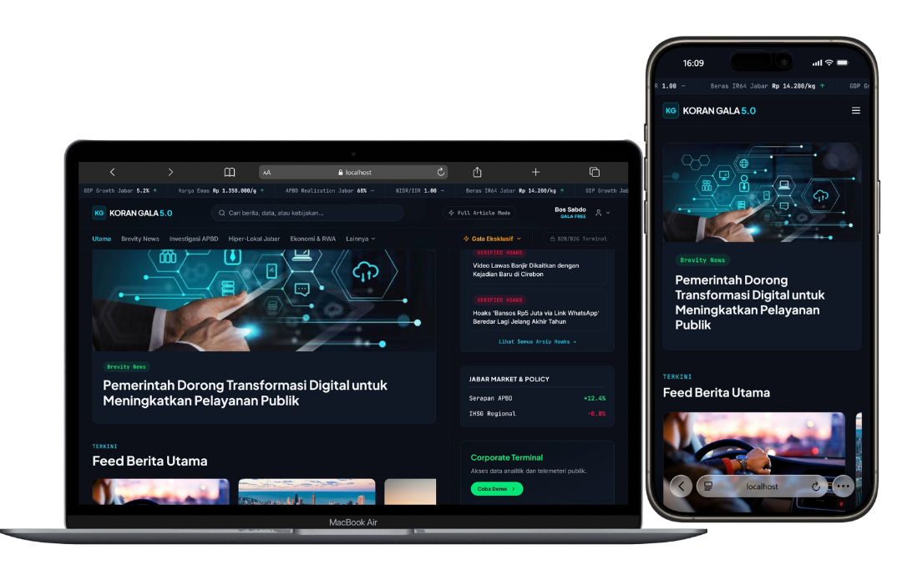
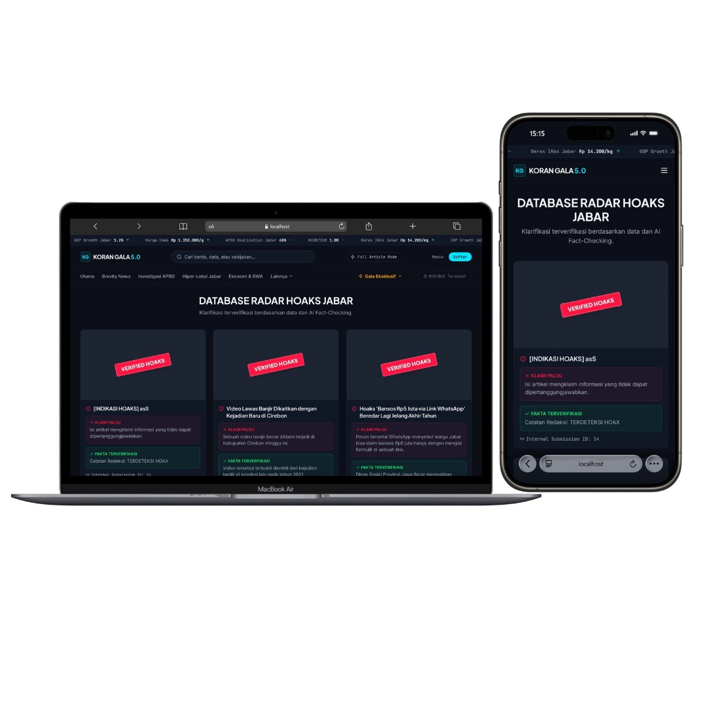
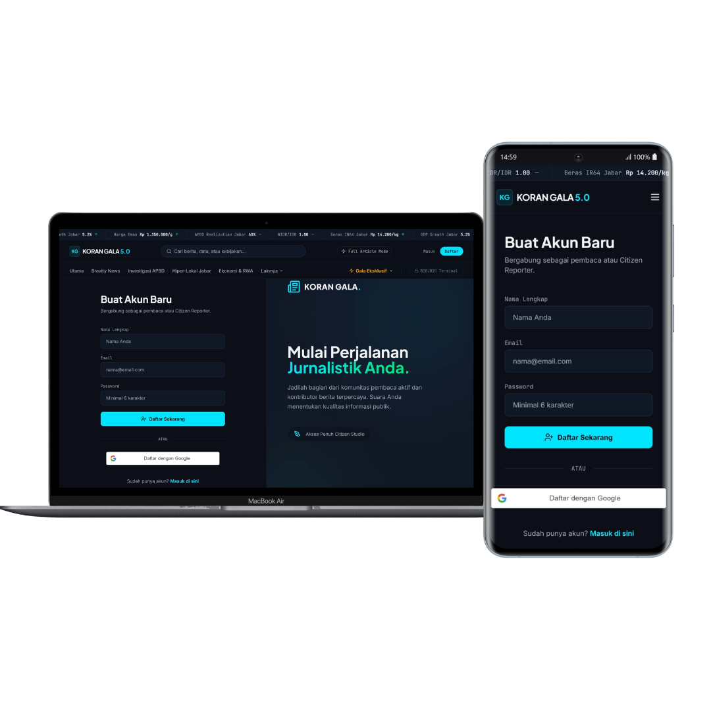
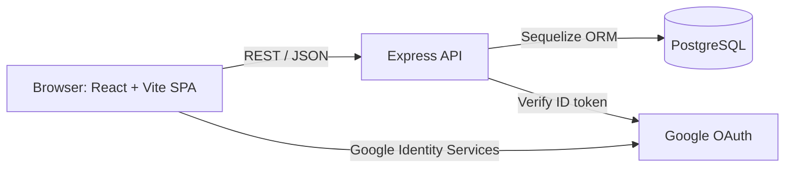
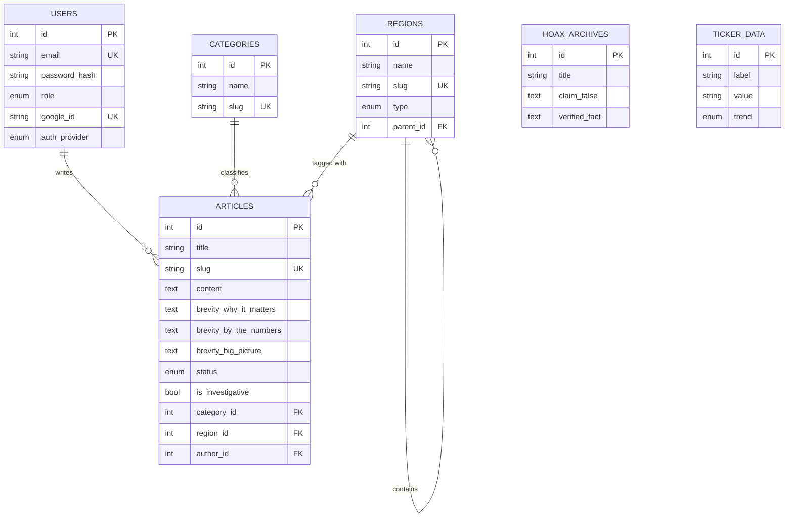

<div align="center">

# Koran Gala 5.0

**A full-stack regional news portal for West Java, Indonesia**
Hyper-local news filtering, a "Smart Brevity" reading mode, an academic archive with auto-citations, and a public hoax archive.


[Live Demo](#) · [Screenshots](#screenshots) · [Getting Started](#getting-started) · [API Overview](#api-overview)

</div>

---

## Table of Contents

- [About](#about)
- [Screenshots](#screenshots)
- [Features](#features)
- [Tech Stack](#tech-stack)
- [Architecture](#architecture)
- [Database Schema](#database-schema)
- [API Overview](#api-overview)
- [Getting Started](#getting-started)
- [Deployment](#deployment)
- [Security Practices](#security-practices)
- [Project Structure](#project-structure)
- [Roadmap](#roadmap)
- [Development Approach](#development-approach)
- [Author](#author)

---

## About

Koran Gala 5.0 is a news portal concept built around the information needs of West Java (Jawa Barat), Indonesia's most populous province. Instead of one national feed, readers can drill down from province to regency/city to district, skim stories in a three-point summary format, and look up historical coverage with ready-to-use academic citations.

The project started from a product brief and was built as a monorepo with a React single-page app and a REST API on Node.js and PostgreSQL. It is a working scaffold with real authentication, role-based access control, and a seeded dataset. It is not a finished commercial product, and the [Roadmap](#roadmap) lists what is still planned.

## Screenshots

> Replace the placeholders below with real screenshots in `docs/screenshots/`.

| Home | 
|---|
|  | 

| Admin Dashboard |
|---|
|  |

| Hoax Archive | Login (Email + Google) |
|---|---|
|  |  |

## Features

**Reader experience**
- **Smart Brevity Mode**: a global toggle that switches any article between the full text and a three-point summary (*Why it matters / By the numbers / The big picture*).
- **Hyper-local filtering**: cascading Regency/City → District selector that filters stories by region.
- **Market ticker bar**: a sticky, auto-scrolling bar of regional indicators, driven by database records.
- **Channel pages**: eleven editorial channels (politics, sport, business, lifestyle, investigations, and more).
- **Reading progress bar** and responsive layout, dark theme by default.

**Research tools**
- **Academic corpus search**: full-text search over the article archive, with channel quick-filters.
- **Auto-citation generator**: one click produces APA, Harvard, Chicago, and BibTeX citations for any article.

**Trust and safety**
- **Public hoax archive**: debunked claims shown next to verified facts, with a "VERIFIED HOAX" stamp and blurred screenshot treatment.

**Accounts and access**
- Email/password registration and login with hashed passwords and JWT sessions.
- **Sign in with Google**: one-click flow that signs in existing users or creates the account on first use.
- **Role-based access control** with four roles (`reader`, `citizen_reporter`, `editor`, `admin`) enforced by API middleware.

## Tech Stack

| Layer | Technologies |
|---|---|
| **Frontend** | React 18, Vite, Tailwind CSS, React Router v6, Zustand, Axios, Lucide React, `@react-oauth/google` |
| **Backend** | Node.js, Express, Sequelize ORM, `google-auth-library`, `jsonwebtoken`, `bcryptjs`, Helmet, CORS, Morgan |
| **Database** | PostgreSQL (local or [Neon](https://neon.tech) serverless) |
| **Tooling** | Nodemon, DBeaver (inspection), Git |

## Architecture



- **Frontend** talks to the API only through one Axios client and one `endpoints.js` service file. A JWT is attached automatically by an interceptor.
- **Backend** follows a routes → controllers → models layering. Responses go through shared `success()` / `fail()` helpers, so every endpoint returns the same JSON shape.
- **Global UI state** (reading mode, auth session) lives in small, separate Zustand stores.

## Database Schema



Regions are self-referencing: a district (`kecamatan`) points to its regency/city (`kabupaten_kota`) through `parent_id`.

## API Overview

Base URL: `http://localhost:4000/api`

| Method | Endpoint | Access | Description |
|---|---|---|---|
| `POST` | `/auth/register` | Public | Create an account |
| `POST` | `/auth/login` | Public | Email/password login, returns JWT |
| `POST` | `/auth/google` | Public | Google sign-in (login or auto-register) |
| `GET` | `/auth/me` | Authenticated | Current user profile |
| `GET` | `/articles` | Public | List articles (`category`, `region`, `q`, `page`, `limit`) |
| `GET` | `/articles/hero` | Public | Featured article |
| `GET` | `/articles/:slug` | Public | Article detail |
| `POST` | `/articles` | Editor, Admin, Citizen reporter | Create article |
| `PUT` | `/articles/:id` | Editor, Admin | Update article |
| `DELETE` | `/articles/:id` | Admin | Delete article |
| `GET` | `/categories` | Public | Editorial channels |
| `GET` | `/regions` | Public | Regencies/cities, or districts via `?parent=<slug>` |
| `GET` | `/hoax` | Public | Hoax archive |
| `GET` | `/ticker` | Public | Ticker bar data |
| `GET` | `/corpus/search` | Public | Archive search |
| `GET` | `/corpus/:id/citation` | Public | APA / Harvard / Chicago / BibTeX |

Every response uses one envelope:

```json
{ "success": true, "data": {}, "meta": { "total": 72, "page": 1, "limit": 10, "totalPages": 8 } }
```


## Roadmap

**Next up**
- [ ] Admin / CMS dashboard (create, edit, publish, and reject articles)
- [ ] Search results page and pagination UI
- [ ] Image upload for article covers (Cloudinary)
- [ ] Rate limiting on authentication endpoints
- [ ] Complete seed data for all 27 regencies/cities of West Java

**Planned**
- [ ] Tiered membership with paywalled features
- [ ] Payment gateway integration (one-time payments first)
- [ ] Email OTP verification when upgrading to a paid tier
- [ ] Interactive map for the hyper-local explorer
- [ ] Automated tests and CI

## Development Approach

This project was built with AI pair-programming assistance, with me acting as product owner and reviewer: defining requirements, choosing the stack, deciding scope and priorities, reviewing generated code, and debugging integration issues such as OAuth origin errors and the MySQL → PostgreSQL migration. My own background is frontend development, and this project was a deliberate way to work through a full-stack architecture end to end.

## Author

<!-- **[Your Name]**
[LinkedIn](https://linkedin.com/in/your-profile) · [Email](mailto:you@example.com) · [Portfolio](#) -->

---

<div align="center">
Built in West Java 🇮🇩
</div>
